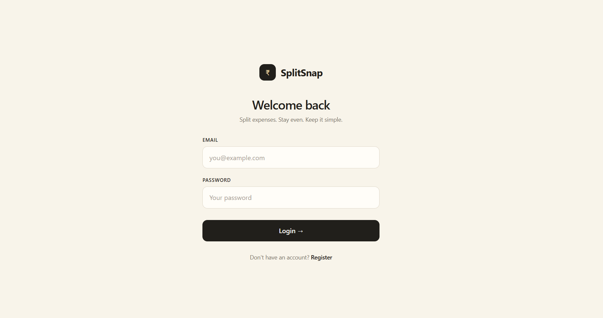
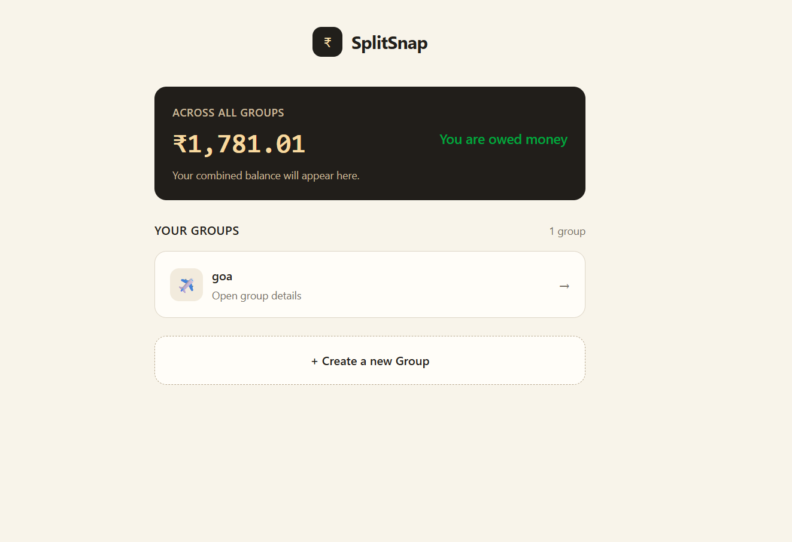
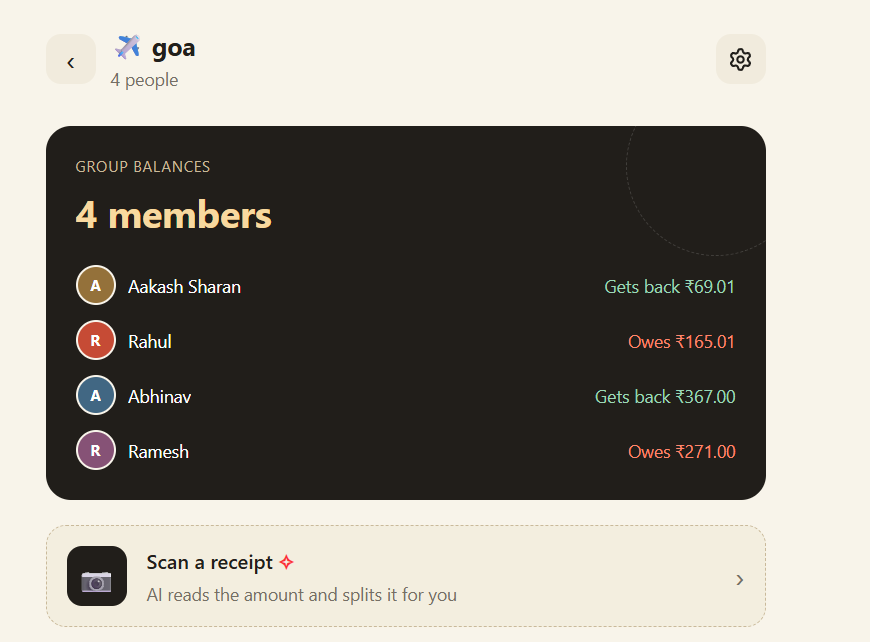
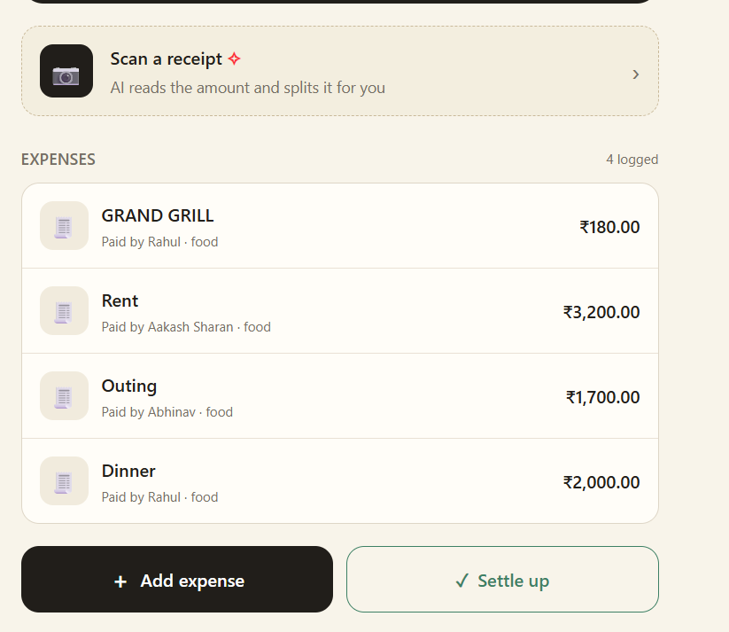
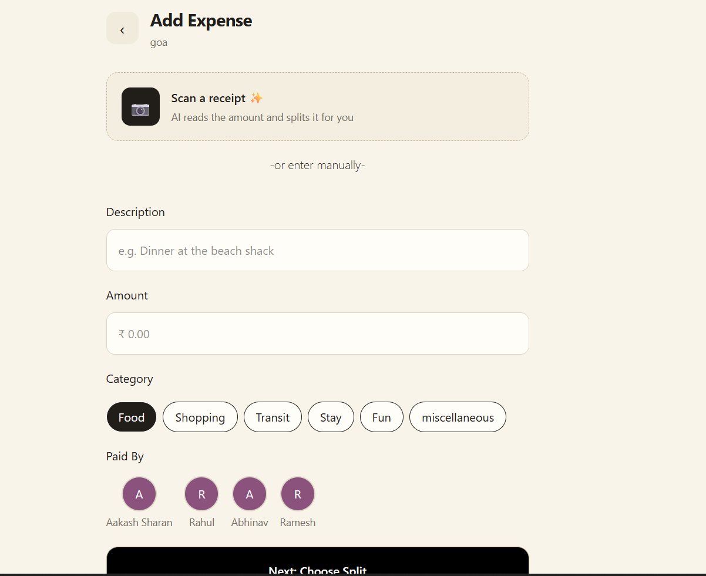
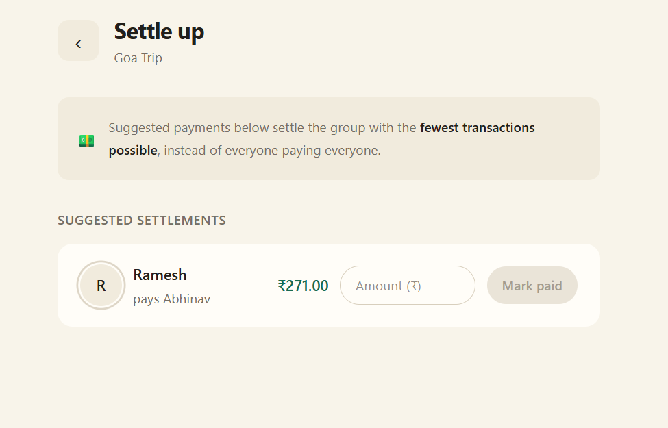

# SplitSnap 💸

**Split expenses. Scan receipts. Settle up without the awkward math.**

SplitSnap is a full-stack expense-sharing app for groups (roommates, trips, friends). Add an expense, choose how to split it, and SplitSnap keeps track of who owes whom. Snap a photo of a receipt and let AI pull out the details for you.

[](https://splitsnap-1.onrender.com)

> **Note:** The demo is hosted on Render's free tier, so the first load after a period of inactivity can take up to a minute while the server wakes up.

> **Status:** Work in progress. Core flows (auth, groups, expenses, balances, receipt scanning) are working; analytics and alerts are on the roadmap. See [Roadmap](#roadmap).

---

## Screenshots

| Login | Dashboard |
|:---:|:---:|
|  |  |

| Group balances | Expenses |
|:---:|:---:|
|  |  |

| Add expense |
|:---:|
|  |

<!-- Add after retaking: | Settle up |  | -->

---

## Features

- **Authentication**: Register and log in with bcrypt-hashed passwords and JWT sessions.
- **Groups**: Create groups, add members, and see everyone's balance at a glance.
- **Dashboard**: One combined balance across all your groups.
- **Expenses with categories**: Food, Shopping, Transit, Stay, Fun and Miscellaneous, with a "paid by" selector.
- **Three split modes**: Equal, exact amount, and percentage.
- **Balances**: Per-member net balance ("gets back" / "owes") calculated from expenses and settlements.
- **Settle up**: Suggested payments to clear the group, plus a one-tap "mark group as settled".
- **AI receipt scanning**: Upload a receipt photo, Gemini reads the amount and details, then you review before saving.
- **Responsive UI**: React + Tailwind CSS.

---

## Tech Stack

| Layer    | Tech |
|----------|------|
| Frontend | React, Vite, Tailwind CSS, React Router |
| Backend  | Node.js, Express.js, Mongoose |
| Database | MongoDB (local or Atlas) |
| Auth     | JWT, bcrypt |
| Uploads  | Multer, ImageKit |
| AI       | Google Gemini API (receipt extraction) |
| Hosting  | Render |

---

## Architecture

```
React + Vite (Frontend)
        │  HTTP + JWT
        ▼
Express API (Backend)
   ├── MongoDB / Mongoose   → users, groups, expenses, settlements
   ├── ImageKit             → receipt image storage
   └── Gemini API           → receipt data extraction
```

### Project structure

```
Splitsnap/
├── Backend/    # Express API, models, routes, controllers
├── Frontend/   # React + Vite client
├── docs/       # README screenshots
└── README.md
```

---

## Getting Started

### Prerequisites

- Node.js (LTS) and npm
- A MongoDB connection string (local or [MongoDB Atlas](https://www.mongodb.com/atlas))
- An [ImageKit](https://imagekit.io/) account (for receipt uploads)
- A [Google Gemini API key](https://aistudio.google.com/) (for receipt scanning)

### 1. Clone

```bash
git clone https://github.com/aakashsharan05-cmd/Splitsnap.git
cd Splitsnap
```

### 2. Backend

```bash
cd Backend
npm install
```

Create `Backend/.env`:

```env
PORT=5000
MONGODB_URI=your_mongodb_connection_string
JWT_SECRET=a_long_random_secret
GEMINI_API_KEY=your_gemini_api_key
IMAGEKIT_PUBLIC_KEY=your_imagekit_public_key
IMAGEKIT_PRIVATE_KEY=your_imagekit_private_key
IMAGEKIT_URL_ENDPOINT=your_imagekit_url_endpoint
```

Start the server:

```bash
npm run dev
```

### 3. Frontend

Open a new terminal:

```bash
cd Frontend
npm install
npm run dev
```

Open the URL Vite prints (usually `http://localhost:5173`).

> Never commit `.env` files. Real keys stay local; share only a `.env.example`.

---

## API Overview

All routes except register/login need `Authorization: Bearer <JWT>`.

| Method | Endpoint                       | Description                  |
|--------|--------------------------------|------------------------------|
| POST   | `/api/auth/register`           | Create an account            |
| POST   | `/api/auth/login`              | Log in, receive a JWT        |
| POST   | `/api/groups`                  | Create a group               |
| GET    | `/api/groups`                  | List your groups             |
| GET    | `/api/groups/:groupId`         | Group details                |
| POST   | `/api/groups/:groupId/members` | Add a member                 |
| GET    | `/api/groups/:groupId/members` | List members                 |
| GET    | `/api/groups/:groupId/balance` | Net balance per member       |
| POST   | `/api/expenses/:groupId`       | Add an expense               |
| GET    | `/api/expenses/:groupId`       | List expenses                |
| POST   | `/api/settlements/:groupId`    | Record a settlement          |
| POST   | `/api/receipts/upload`         | Upload and scan a receipt    |

---

## How Splitting Works

| Mode           | Rule |
|----------------|------|
| **Equal**      | Total ÷ number of participants |
| **Exact**      | Each person's amount is given; amounts must add up to the total |
| **Percentage** | Each person's share is given in %; percentages must add up to 100 |

**Balance logic:** for every member, `net = (what they paid) − (what they owe) ± settlements`. Positive means they get money back, negative means they owe. Across a group, all positives and negatives cancel out to zero.

---

## Security Notes

- Passwords are hashed with bcrypt, never stored in plain text.
- Protected routes verify the JWT on every request.
- Group membership is checked on the server before reading or changing group data.
- Amounts, split totals and uploads are validated on the backend; the client is never trusted for money logic.
- Secrets live in environment variables only.

---

## Roadmap

- [ ] Store money as integers (paise) to avoid floating-point rounding errors
- [ ] Unit tests for split, balance and settle-up logic
- [ ] Partial settlements with outstanding-balance validation
- [ ] Expense analytics (monthly / category charts)
- [ ] Balance-threshold email alerts
- [ ] Better loading, empty and error states
- [ ] Demo GIF of the full flow

---

## Contributing

This is a learning and portfolio project. Bug reports and suggestions are welcome: open an issue with steps to reproduce.

## License

MIT, see [LICENSE](LICENSE). _(Add a `LICENSE` file to the repo.)_

---

Built by [@aakashsharan05-cmd](https://github.com/aakashsharan05-cmd) with React, Node.js, Express, MongoDB and Gemini.